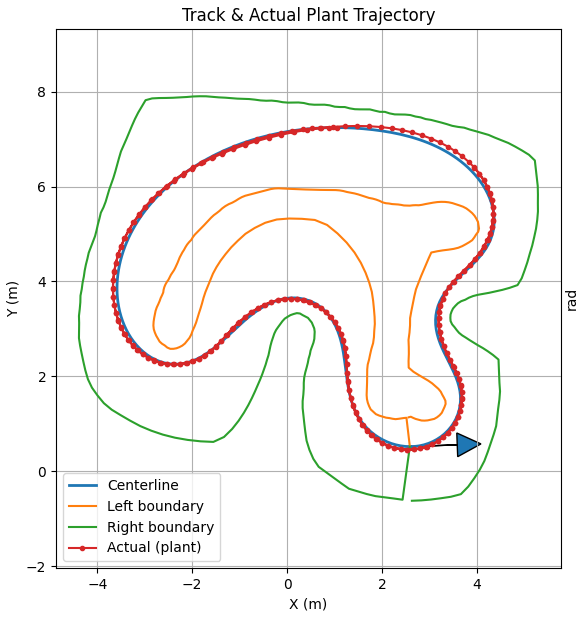
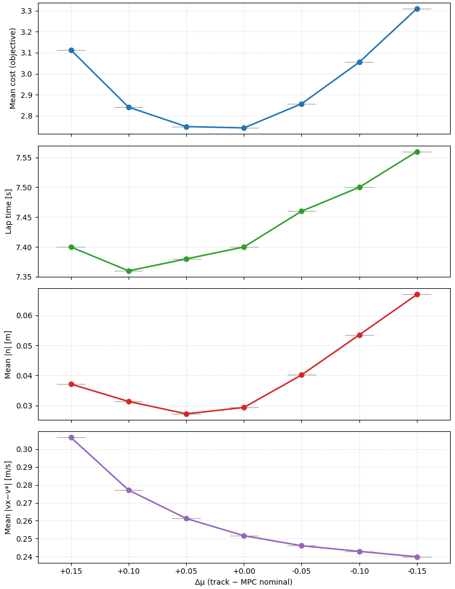
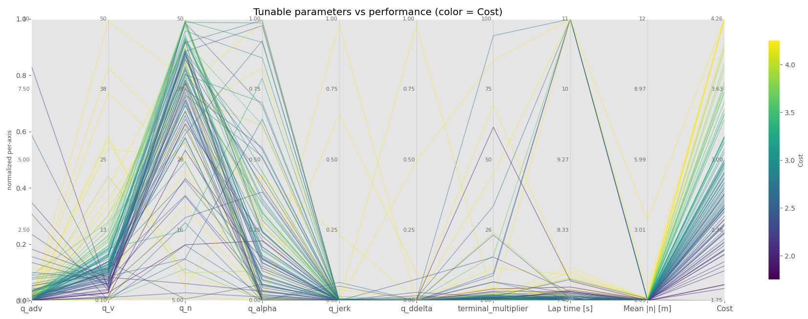

# 🏎️ `mpc_sim` — Modular Offline Simulation for the ForzaETH race stack MPC

`mpc_sim` is a **lightweight and modular simulation toolbox** developed within the **ForzaETH F1TENTH race stack**.
It is designed to **test the exact same MPC controller used in the real autonomous racecar**, while being completely **independent of ROS**.

It directly interfaces with the same modules used on-board:
- `STMPC.py` (Single Track MPC)
- `acados_settings.py`
- `bicycle_model.py`

and uses the **same configuration files, parameters, and saved tracks** from the ForzaETH race stack.

---

## 🧠 Overview

- **ROS-free** — Runs the exact MPC fully offline for fast simulation.
- **Plant model** — Uses the same dynamics as the MPC, with extra features like variable friction μ and noise injection.
- **Same MPC as in race stack** — Uses the identical MPC code from the race stack for direct validation.
- **Modularity** — Easily extendable for additional tests.

---

## 📂 Folder Overview

```
mpc_sim/
├─ cli/             # Command-line tests and experiments
│  ├─ run_single_rollout.py      # Run a single closed-loop simulation
│  ├─ analyze_cost_vs_mu.py      # Study performance vs friction assumption
│  └─ tune_mpc_weights.py        # Autotune cost weights with Optuna
│
├─ core/            # Core simulation engine
│  ├─ scenario.py   # Load configs, track and build STMPC
│  ├─ controllers.py# Interface with STMPC class (parameter update, solve)
│  ├─ plant.py      # Integrate dynamics using bicycle_model
│  └─ rollout.py    # Execute closed-loop simulation
│
├─ io/waypoints.py  # Load and standardize waypoints to (N,7) arrays
├─ metrics/         # Compute lap time, errors, and other KPIs
├─ plotting/        # Visualize predictions, trajectories, and tuning results
└─ utils/           # Integrators and helpers
````
---

## 🧪 Available Tests

Each CLI script supports a full set of command-line arguments, **but every parameter has a default** — so you can start testing immediately without specifying anything.

To execute the scripts, make sure you are positioned **one level above the `mpc_sim` folder** (inside the `mpc` directory) and run:

```bash
python -m mpc_sim.cli.run_single_rollout
````

### 1. `run_single_rollout.py` — Closed-Loop Simulation
Run a single MPC rollout using real parameters and tracks.

```bash
python -m mpc_sim.cli.run_single_rollout \
  --track THETRACK --racecar_version NUC5 --floor dubi --refline iqp \
  --dt 0.02 --steps 400 --integrator rk4 \
  --mu_track 1.00 --mu_mpc 1.00 \
  --s0 20 --n0 0.0 --psi0 0.0 --vx0 3.0 \
  --vis_spaghetti_predictions_vs_actual \
  --vis_state_prediction_vs_actual \
  --vis_target_vel_actual
````

✅ Simulates the full MPC loop, using the same dynamics, parameters, and solver configuration as in the car.

✅ Plots predicted vs actual trajectories, target vs actual speeds, and a summary.



---

### 2. `analyze_cost_vs_mu.py` — Friction Sensitivity

Evaluate how the controller performs when the **track friction** and **MPC-assumed friction** differ.

```bash
python -m mpc_sim.cli.analyze_cost_vs_mu \
  --track THETRACK --racecar_version NUC5 --floor dubi \
  --dt 0.02 --steps 400 --mu_track 1.00 \
  --mu_mpc_list 0.85 0.90 0.95 1.00 1.05 1.10 1.15
```

✅ Compares lap time, cost, and stability for different friction assumptions.

✅ Produces visual reports with cost trends and performance summaries.

<p align="center">
  
</p>

---

### 3. `tune_mpc_weights.py` — MPC Weight Autotuning

Use **Optuna** to automatically tune cost weights for optimal performance.

```bash
python -m mpc_sim.cli.tune_mpc_weights \
  --track THETRACK --racecar_version NUC5 --floor dubi \
  --dt 0.02 --steps 400 --trials 40 \
  --mu_track 1.00 --mu_mpc 1.00 \
  --w_lt 1.0 --w_cost 0.0 --w_abs_n 0.1 --w_abs_v 0.0 \
  --vis_parallel
```

✅ Minimizes a weighted objective combining lap time, MPC cost, and trajectory errors.

✅ Displays optimization progress, parallel coordinate plots, and best results.



---

## 🧩 Extending the Framework

Adding a new test is easy:

1. Create a new file under `cli/`, e.g. `test_new_scenario.py`.
2. Import core modules:

   ```python
   from mpc_sim.core import Scenario, Plant, RolloutRunner
   from mpc_sim.core.controllers import ControllerMPC
   ```
3. Build your experiment for the MPC.
4. Use existing metrics and plotting utilities for evaluation.

This design keeps the **MPC logic untouched** and allows **rapid experimentation** with parameters, friction, models, or cost structures.

---

## 📈 Typical Workflow

1. **Single run:** verify stability and correctness.
2. **μ sweep:** study robustness to grip mismatch.
3. **Weight tuning:** optimize controller performance.
4. **Extend:** create custom scenarios or evaluation criteria.

---

## 🏁 Summary

`mpc_sim` is an integral part of the **ForzaETH race stack**, providing a **simple, modular, and ROS-free** way to test, analyze, and tune the **same MPC** used in the race stack.

It bridges **simulation and real-world racing**, ensuring every control update can be validated **offline, reproducibly, and transparently** before hitting the track.

---