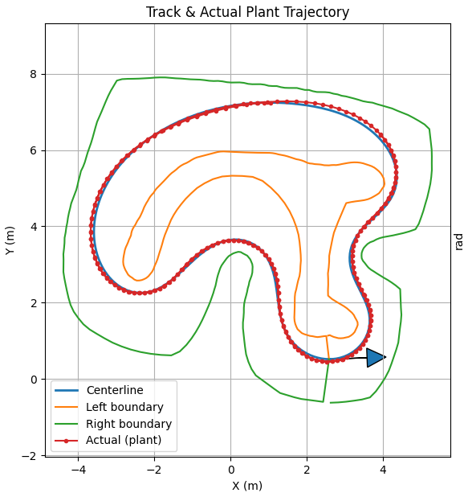
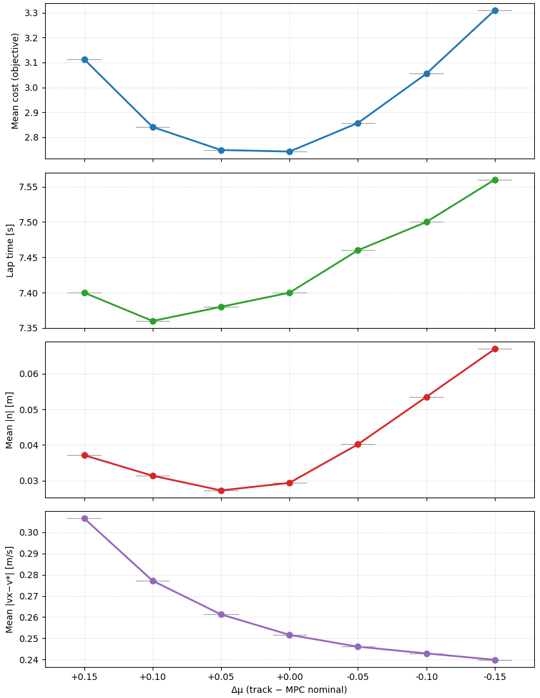
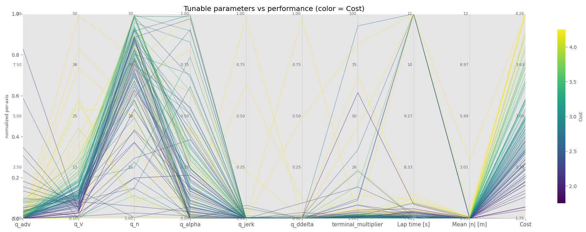

# 🏎️ `forzaeth_mpc.sim` — offline simulation for the ForzaETH MPCs

A small closed-loop simulator that drives **the same controller objects the car runs**, with no
ROS. It builds them through their real constructors — `ControllerMPC` (STMPC),
`ControllerKMPC` and `ControllerLBMPC` over `stmpc/`, `kmpc/` and `lbmpc/` — and reads the same
config schemas and exported tracks.

---

## 🧠 Overview

- **ROS-free** — no rospy, no roscore, no message types. Enforced, not aspirational.
- **All three controllers** — KMPC, STMPC and LB-MPC through one adapter interface.
- **Same code as the car** — the controller classes themselves, not a reimplementation.
- **Plant** — the controller's own dynamics, plus a friction knob (`--mu_track` vs `--mu_mpc`)
  and optional state noise, so model mismatch can be introduced deliberately.

---

## 📂 Folder Overview

```
forzaeth_mpc/sim/
├─ cli/             # runnable entry points
│  ├─ run_laps.py                # N laps, fixed metrics, all three algorithms
│  ├─ run_single_rollout.py      # one closed-loop rollout + plots
│  ├─ analyze_cost_vs_mu.py      # performance vs assumed friction
│  ├─ tune_mpc_weights.py        # cost-weight autotuning with Optuna
│  └─ noise_robustness_analysis.py
│
├─ core/            # simulation engine
│  ├─ scenario.py   # load configs + track, build any of the three controllers
│  ├─ controllers.py# ControllerMPC / ControllerKMPC / ControllerLBMPC adapters
│  ├─ plant.py      # integrate the controller's own dynamics
│  └─ rollout.py    # closed-loop loop
│
├─ tracks.py        # read a global_waypoints.json straight to an (N,7) array
├─ waypoints.py     # the canonical (N,7) column layout
├─ metrics/         # lap times, tracking error, solver success
├─ plotting/        # figures
└─ utils/           # integrators
````
---

## 🧪 Available Tests

Each CLI script supports a full set of command-line arguments, **but every parameter has a default** — so you can start testing immediately without specifying anything.

Run them from the repo root (or anywhere, once the package is pip-installed):

```bash
python -m forzaeth_mpc.sim.cli.run_single_rollout
```

Plotting needs a display; without one, set `MPLBACKEND=Agg` and the figures are skipped.

### 0. `run_laps.py` — the benchmark

N laps for any of the three controllers, with a fixed metric set written to json. This is
what `BENCHMARK.md` reports.

```bash
python -m forzaeth_mpc.sim.cli.run_laps --algo stmpc kmpc lbmpc --laps 20 --plot
```

The control period defaults to `1 / MPC_freq` from each algorithm's own config rather than a
harness choice — KMPC's plant is a discrete model that advances exactly one period per call.

### 1. `run_single_rollout.py` — Closed-Loop Simulation
Run a single MPC rollout using real parameters and tracks.

```bash
python -m forzaeth_mpc.sim.cli.run_single_rollout \
  --track THETRACK --racecar_version NUC5 --floor dubi --refline iqp \
  --dt 0.02 --steps 600 --integrator rk4 \
  --mu_track 1.00 --mu_mpc 1.00 \
  --s0 20 --n0 0.0 --psi0 0.0 --vx0 3.0 \
  --vis_spaghetti_predictions_vs_actual \
  --vis_state_prediction_vs_actual \
  --vis_target_vel_actual
````

✅ Simulates the full MPC loop, using the same dynamics, parameters, and solver configuration as in the car.

✅ Plots predicted vs actual trajectories, target vs actual speeds, and a summary.



---

### 2. `analyze_cost_vs_mu.py` — Friction Sensitivity

Evaluate how the controller performs when the **track friction** and **MPC-assumed friction** differ.

```bash
python -m forzaeth_mpc.sim.cli.analyze_cost_vs_mu \
  --track THETRACK --racecar_version NUC5 --floor dubi \
  --dt 0.02 --steps 700 --mu_track 1.00 \
  --mu_mpc_list 0.85 0.90 0.95 1.00 1.05 1.10 1.15
```

✅ Compares lap time, cost, and stability for different friction assumptions.

✅ Produces visual reports with cost trends and performance summaries.

<p align="center">
  
</p>

---

### 3. `tune_mpc_weights.py` — MPC Weight Autotuning

Use **Optuna** to automatically tune cost weights for optimal performance.

```bash
python -m forzaeth_mpc.sim.cli.tune_mpc_weights \
  --track THETRACK --racecar_version NUC5 --floor dubi \
  --dt 0.02 --steps 900 --trials 40 \
  --mu_track 1.00 --mu_mpc 1.00 \
  --w_lt 1.0 --w_cost 0.0 --w_abs_n 0.1 --w_abs_v 0.0 \
  --vis_parallel
```

✅ Minimizes a weighted objective combining lap time, MPC cost, and trajectory errors.

✅ Displays optimization progress, parallel coordinate plots, and best results.



---

## 🧩 Extending the Framework

Adding a new test is easy:

1. Create a new file under `cli/`, e.g. `test_new_scenario.py`.
2. Import core modules:

   ```python
   from forzaeth_mpc.sim.core import Plant, RolloutRunner, Scenario
   from forzaeth_mpc.sim.core.controllers import ControllerMPC
   ```
3. Build your experiment for the MPC.
4. Use existing metrics and plotting utilities for evaluation.

This design keeps the **MPC logic untouched** and allows **rapid experimentation** with parameters, friction, models, or cost structures.

---

## 📈 Typical Workflow

1. **Single run:** verify stability and correctness.
2. **μ sweep:** study robustness to grip mismatch.
3. **Weight tuning:** optimize controller performance.
4. **Extend:** create custom scenarios or evaluation criteria.

---

## 🏁 Summary

`forzaeth_mpc.sim` is how these controllers get tested, analysed and tuned before they reach a car.

It bridges **simulation and real-world racing**, ensuring every control update can be validated **offline, reproducibly, and transparently** before hitting the track.

---